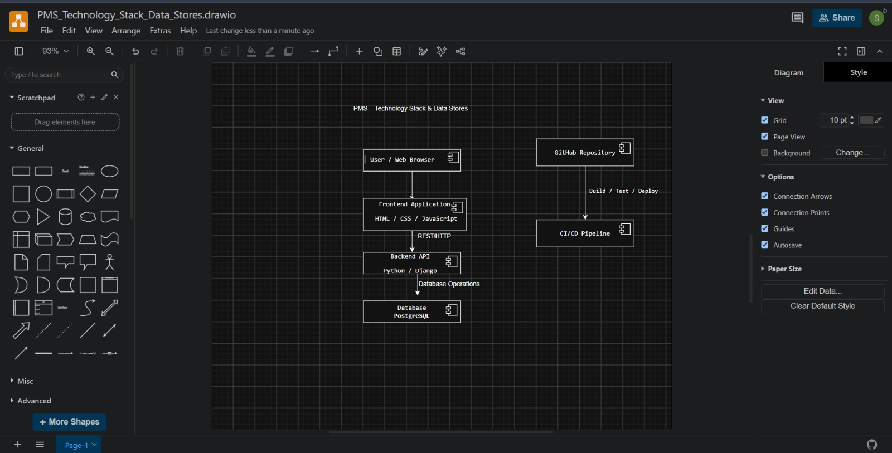

# Project Management System (PMS)

A Software Engineering project designed to build a centralized, web-based platform for managing projects, tasks, workflows, sprints, and team collaboration.

---

## 👥 Team 11 Profile

| S.No. | Name | SRN | Role / Module Assignment |
| :---: | :--- | :--- | :--- |
| 1 | **Shivansh Sharma** | PES2UG24CS474 | Repo Setup, Architecture, CI/CD Pipeline |
| 2 | **Shibi R Shetty** | PES2UG24CS467 | Backend Architecture & Project Management Module |
| 3 | **Sheetal S Bevinakatti** | PES2UG24CS466 | Frontend Development , Testing & QA |
| 4 | **Shivanagouda I Patil** | PES2UG24CS471 | Requirements Analysis & Project Documentation |

---

## 🏗️ Architecture Overview

The system architecture follows a layered structure separating presentation, application business logic, and data persistence:



- **Frontend**: HTML5, CSS, and JavaScript rendered via Django templates.
- **Backend API**: Python / Django framework structured into modular applications (`accounts`, `projects`, `tasks`).
- **Data Store**: Relational database (PostgreSQL in production / SQLite for local development & testing).
- **CI/CD Pipeline**: GitHub Actions for automated linting, migration verification, and test execution.

---

## 📁 Repository Structure

```text
Project-Management-System/
├── README.md               # Project overview, architecture, and team guide
├── .gitignore              # Git ignore rules for Python, Django, and virtual environments
├── backend/                # Django backend application root
│   ├── manage.py           # Django administrative utility
│   ├── requirements.txt    # Python dependencies list
│   ├── config/             # Django settings and main URL configuration
│   ├── accounts/           # User authentication and profile module
│   ├── projects/           # Project management module
│   ├── tasks/              # Task and Kanban management module
│   └── tests/              # Test suite for unit and integration testing
├── docs/                   # Approved documents, specifications, and architecture
│   ├── SRS.pdf             # Software Requirements Specification
│   ├── Software-Test-Plan.pdf # Software Test Plan (STP)
│   ├── architecture.png    # System architecture and data flow diagram
│   ├── Project_Proposal.pdf
│   ├── SASD_Specification.docx
│   ├── Sprint1_Requirements_Analysis.pdf
│   └── Requirements_Matrix.pdf
├── templates/              # Django HTML templates (Frontend)
├── static/                 # Static assets: CSS, JavaScript, and images
└── .github/
    └── workflows/
        ├── tests.yml         # GitHub Actions automated test workflow
        └── deploy-render.yml # Gated Render deployment workflow
```

---

## 🚀 Getting Started

### 1. Clone Repository
```bash
git clone https://github.com/Project-Management-System-SE/Project-Management-System-SE.git
cd Project-Management-System-SE
```

### 2. Setup Virtual Environment
```bash
# Windows
python -m venv venv
venv\Scripts\activate

# Linux / macOS
python3 -m venv venv
source venv/bin/activate
```

### 3. Install Dependencies
```bash
pip install -r backend/requirements.txt
```

### 4. Configure email for password resets

For local development, use Django's console email backend so registration confirmation emails and
password-reset links are printed in the development server output instead of requiring an SMTP
account.

After login, the session remains active for 30 days without requiring an extra checkbox. The
browser can offer to save and autofill the email and password using its password manager; the
application does not store a readable copy of the password.

```powershell
# Windows PowerShell
$env:DJANGO_EMAIL_BACKEND = "django.core.mail.backends.console.EmailBackend"
```

```bash
# Linux / macOS
export DJANGO_EMAIL_BACKEND=django.core.mail.backends.console.EmailBackend
```

For deployment, configure an SMTP backend and provide the mail server settings through
environment variables: `DJANGO_EMAIL_BACKEND`, `DJANGO_EMAIL_HOST`, `DJANGO_EMAIL_PORT`,
`DJANGO_EMAIL_HOST_USER`, `DJANGO_EMAIL_HOST_PASSWORD`, `DJANGO_EMAIL_USE_TLS`, and
`DJANGO_DEFAULT_FROM_EMAIL`. Do not commit credentials. Password-reset links expire after 24 hours.

### 5. Run the application

The development entry point enables Django debug mode by default, so `runserver`
serves the files in the repository's `static/` directory:

```powershell
# Windows PowerShell
python manage.py runserver
```

```bash
# Linux / macOS
python manage.py runserver
```

```bash
python backend/manage.py migrate
python backend/manage.py runserver
```

If you invoke Django through another entry point, enable development static-file
serving explicitly:

```powershell
# Windows PowerShell
$env:DJANGO_DEBUG = "true"
```

```bash
# Linux / macOS
export DJANGO_DEBUG=true
```

To explicitly disable debug mode, set `DJANGO_DEBUG=false` and provide a
`DJANGO_SECRET_KEY`.

### Project management

Open **Projects** and select **View project** to see project details and membership. Project
Admins and that project's Project Managers can edit, archive, and delete it. Project Managers may
add or remove active, non-admin users as Team Members; only Admins can grant or remove a
Project Manager role. A project's owner remains a Project Manager and cannot be removed from its
own membership. Deletion requires confirmation and removes the project and its memberships, not
the member accounts. Project changes and membership mutations require authenticated, CSRF-protected
requests.

Project and task creations, updates, status changes, sprint carry-over changes, and deletions are
retained in the project activity history. Authorized project users can view live project history
newest first; authorized users retained in the deletion event can also open a deleted project's
history by its original project ID. Audit rows retain project/task IDs and names, actor snapshots,
and project authorization snapshots when related records are deleted. There is no automatic
expiration, so retention follows the lifetime of the PMS database.

Audit entries are append-only at the Django application layer: model saves/deletes, queryset
updates/deletes, bulk updates, and bulk creates are rejected after creation, and the admin exposes
entries as read-only with deletion disabled. This is not database-level tamper protection; a
database role with direct write access could bypass it. Production deployments requiring stronger
tamper resistance should use database permissions, append-only storage, or an external audit sink.

Open a project's **Tasks** page to switch between the task list and a status board. Task cards link
to their details; users with task edit permission can update status and other task fields there.
The dashboard counts tasks assigned to the signed-in user within visible projects, and project
progress is the percentage of tasks marked Done. Use **My Tasks** to view those assigned tasks.
Project and task search supports the currently available fields; sprint and milestone planning is
available from each project's planning page.

Task attachments are stored below `backend/media` by default (override with `DJANGO_MEDIA_ROOT`)
and are served only through authenticated, project-authorized downloads. Configure the upload limit
with `TASK_ATTACHMENT_MAX_SIZE_BYTES` (default 10 MiB) and the comma-separated extension allowlist
with `TASK_ATTACHMENT_ALLOWED_EXTENSIONS` (default: `pdf,txt,csv,png,jpg,jpeg,gif,doc,docx,xls,xlsx`).
Uploads must be non-empty, within the size limit, and pass a standard-library signature or structure
check for the selected extension. This content validation is not malware scanning.

**Issue #19 permission coordination:** collaboration currently follows `can_view_tasks_for`: active
project members, project owners, and admins may view and add comments or attachments, while task
editing continues to use the narrower `can_edit_task` rule. Confirm this distinction with the
issue #19 owner before changing collaboration permissions.

### Task viewing and status updates

Open **Tasks** in the sidebar or choose **View tasks** from a project. Project members can view
tasks in projects they can access. Project Admins and Project Managers can update any task
status; an authorized project member can update a task assigned to them or created by them.
The project task page displays a Kanban board with **Backlog**, **To Do**, **In Progress**,
**Review**, and **Done** columns. Tasks can move one stage at a time; a task must pass through
Review before it can be marked Done. Task details also support creation, editing, deletion, and
project-scoped labels.

Invalid status values are rejected without changing the saved task. Run
`python backend/manage.py migrate` after pulling changes to apply database migrations.

### Task and membership notifications

The application stores notifications in the signed-in user's **Notifications** inbox when they are
added to or removed from a project, assigned a task, or notified about a task status change or
comment. Status and comment notifications go to the task assignee and creator, excluding the
person who made the change. Task assignees receive one in-app due-date reminder the day before a
task is due. Registration confirmation and password-reset messages continue to use email.

Run `python backend/manage.py send_due_date_reminders` daily to create due-date reminders. Schedule
this command with Windows Task Scheduler or a deployment scheduler; the command records sent
reminders so repeated runs do not create duplicates.

### Dashboards and reports

The dashboard shows an active-sprint burndown using estimated hours and task completion dates, plus
velocity across completed sprints. Velocity is the estimated effort of tasks completed in each sprint;
the accompanying CSV also includes actual effort. Projects with no task estimates show an explanation
instead of an empty chart.

Project members can download **Progress summary**, **Sprint velocity**, and **Team workload** CSV
files from a project's details page. CSV exports are scoped to projects the signed-in user can view.
Spreadsheet-formula prefixes in user-provided text are escaped in exports.

### JSON API

The versioned API uses Django session authentication. Unsafe requests require the normal Django CSRF
token; anonymous requests receive JSON `401` responses, and project data is limited to projects
visible to the signed-in user. Task writes use the same project permissions, workflow validation,
notifications, and audit logging as the web interface. Responses use JSON and standard HTTP status
codes. Task lists accept the web filters (`q`, `assignee`, `priority`, `status`, `label`, and `sprint`)
and are paginated with `page` (default `1`) and `page_size` (default `100`, maximum `100`).

| Method | Endpoint | Purpose |
| --- | --- | --- |
| `GET` | `/api/v1/projects/` | List visible projects |
| `GET` | `/api/v1/projects/{project_id}/` | Read a visible project |
| `GET` | `/api/v1/projects/{project_id}/tasks/` | Search and filter project tasks |
| `POST` | `/api/v1/projects/{project_id}/tasks/` | Create a task as a project member |
| `GET` | `/api/v1/projects/{project_id}/tasks/{task_id}/` | Read a visible task |
| `PATCH` | `/api/v1/projects/{project_id}/tasks/{task_id}/` | Update a task you may edit |
| `DELETE` | `/api/v1/projects/{project_id}/tasks/{task_id}/` | Delete a task as a project manager |

Task create/update bodies are JSON objects. Supported fields are `title`, `description`, `priority`,
`due_date`, `estimated_effort`, `actual_effort`, `assignee`, `sprint`, `milestone`, `status`, and
`labels` (an array of strings); user and planning relations use their numeric IDs. Task status changes
must follow the project's workflow. For example:

```json
{
  "title": "Review API integration",
  "priority": "HIGH",
  "assignee": 12,
  "estimated_effort": "2.50",
  "labels": ["integration", "backend"]
}
```

The API currently uses session/CSRF authentication; it does not issue personal access tokens and does
not include bundled Slack or GitHub connectors.

### HTTPS and backups

For deployments, set `DJANGO_DEBUG=false`, a strong `DJANGO_SECRET_KEY`, and `DJANGO_ALLOWED_HOSTS`.
With debug disabled, HTTPS redirects and secure session/CSRF cookies are enabled by default; override
them only when the deployment topology requires it. If TLS terminates at a reverse proxy, set
`DJANGO_TRUST_X_FORWARDED_PROTO=true` only when that proxy removes any client-supplied
`X-Forwarded-Proto` header and writes its own. Enable HSTS with `DJANGO_SECURE_HSTS_SECONDS` only
after confirming HTTPS is permanent for the deployment domain.

Create a compressed database and uploaded-media backup with:

```powershell
python backend\manage.py backup_database
```

By default, archives are written to `backend\backups`; set `DJANGO_BACKUP_DIR` or pass `--output-dir`
to select protected storage outside the web root and repository. Schedule this command daily using
Windows Task Scheduler or the deployment scheduler, and periodically test restore procedures. Each
archive contains a Django `database.json` fixture, a manifest, and files from `DJANGO_MEDIA_ROOT`.
To restore, load the fixture with `python backend\manage.py loaddata <database.json>` and restore the
archive's `media` files to `DJANGO_MEDIA_ROOT`. On a fresh database, apply migrations before loading
the fixture. Backups contain personal data and password hashes; restrict access and encrypt them at
rest.

### Render deployment

The application supports Render PostgreSQL through `DATABASE_URL`, serves collected static assets
with WhiteNoise, and exposes `/health/` as a database-aware health check. Set the Render web
service's **Root Directory** to `backend` and configure:

- **Build command:** `python -m pip install -r requirements.txt && python manage.py collectstatic --noinput`
- **Start command:** `python manage.py migrate --noinput && python -m gunicorn config.wsgi:application --bind 0.0.0.0:$PORT`
- **Health check path:** `/health/`

`backend/requirements.txt` installs Gunicorn, Psycopg, `dj-database-url`, and WhiteNoise. The
`python -m gunicorn` invocation uses the same Python environment that installed the dependencies.
Attach a Render PostgreSQL database and set `DATABASE_URL` to its internal connection string.
`DATABASE_URL` is required when `DJANGO_DEBUG=false`; startup fails rather than falling back to
SQLite if it is missing. Also configure `DJANGO_DEBUG=false`, a long random `DJANGO_SECRET_KEY`,
`DJANGO_ALLOWED_HOSTS`, and `DJANGO_TRUST_X_FORWARDED_PROTO=true`. Production enables HTTPS
redirect, secure cookies, and one-year HSTS by default; only reduce `DJANGO_SECURE_HSTS_SECONDS`
if HTTPS is not permanently available. Leave HSTS subdomain and preload options disabled unless
every affected hostname is HTTPS-only and you intentionally want the browser-preload commitment.
Set `DJANGO_MEDIA_ROOT=/var/data/media` and attach persistent storage mounted at `/var/data`, or
configure durable object storage; Render's service filesystem is ephemeral and task attachments
would otherwise be lost on redeploy. Configure the SMTP environment variables above for
registration and password-reset email.

The **Render CD** workflow is gated on successful CI for a push to `main`. To require manual approval,
create a GitHub environment named `production`, add required reviewers to its protection rules, and
save the Render service's deploy-hook URL as the environment secret `RENDER_DEPLOY_HOOK_URL`. The
workflow then waits for approval before asking Render to deploy. Create the Render service and
database, configure its persistent media storage and environment variables, and connect it to the
`main` branch before enabling this workflow. Creating these external resources may incur provider
charges; confirm the selected plans in Render before provisioning them.
