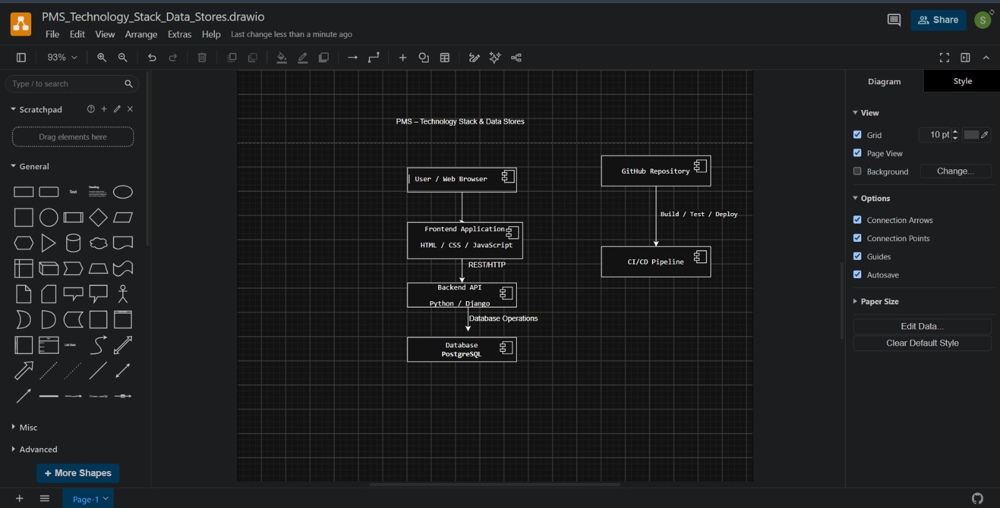

# Project Management System (PMS)

A Software Engineering project designed to build a centralized, web-based platform for managing projects, tasks, workflows, sprints, and team collaboration.

---

## 👥 Team 11 Profile

| S.No. | Name | SRN | Role / Module Assignment |
| :---: | :--- | :--- | :--- |
| 1 | **Shivansh Sharma** | PES2UG24CS474 | Repo Setup, Architecture, CI/CD Pipeline |
| 2 | **Shibi R Shetty** | PES2UG24CS467 | Backend Architecture & Project Management Module |
| 3 | **Sheetal S Bevinakatti** | PES2UG24CS466 | Frontend Development , Testing & QA |
| 4 | **Shivanagouda I Patil** | PES2UG24CS471 | Requirements Analysis & Project Documentation |

---

## 🏗️ Architecture Overview

The system architecture follows a layered structure separating presentation, application business logic, and data persistence:



- **Frontend**: HTML5, CSS, and JavaScript rendered via Django templates.
- **Backend API**: Python / Django framework structured into modular applications (`accounts`, `projects`, `tasks`).
- **Data Store**: Relational database (PostgreSQL in production / SQLite for local development & testing).
- **CI/CD Pipeline**: GitHub Actions for automated linting, migration verification, and test execution.

---

## 📁 Repository Structure

```text
Project-Management-System/
├── README.md               # Project overview, architecture, and team guide
├── .gitignore              # Git ignore rules for Python, Django, and virtual environments
├── backend/                # Django backend application root
│   ├── manage.py           # Django administrative utility
│   ├── requirements.txt    # Python dependencies list
│   ├── config/             # Django settings and main URL configuration
│   ├── accounts/           # User authentication and profile module
│   ├── projects/           # Project management module
│   ├── tasks/              # Task and Kanban management module
│   └── tests/              # Test suite for unit and integration testing
├── docs/                   # Approved documents, specifications, and architecture
│   ├── SRS.pdf             # Software Requirements Specification
│   ├── Software-Test-Plan.pdf # Software Test Plan (STP)
│   ├── architecture.png    # System architecture and data flow diagram
│   ├── Project_Proposal.pdf
│   ├── SASD_Specification.docx
│   ├── Sprint1_Requirements_Analysis.pdf
│   └── Requirements_Matrix.pdf
├── templates/              # Django HTML templates (Frontend)
├── static/                 # Static assets: CSS, JavaScript, and images
└── .github/
    └── workflows/
        └── tests.yml       # GitHub Actions automated test workflow
```

---

## 🚀 Getting Started

### 1. Clone Repository
```bash
git clone https://github.com/Project-Management-System-SE/Project-Management-System-SE.git
cd Project-Management-System-SE
```

### 2. Setup Virtual Environment
```bash
# Windows
python -m venv venv
venv\Scripts\activate

# Linux / macOS
python3 -m venv venv
source venv/bin/activate
```

### 3. Install Dependencies
```bash
pip install -r backend/requirements.txt
```

### 4. Configure email for password resets

For local development, use Django's console email backend so reset links are printed in the
development server output instead of requiring an SMTP account.

```powershell
# Windows PowerShell
$env:DJANGO_EMAIL_BACKEND = "django.core.mail.backends.console.EmailBackend"
```

```bash
# Linux / macOS
export DJANGO_EMAIL_BACKEND=django.core.mail.backends.console.EmailBackend
```

For deployment, configure an SMTP backend and provide the mail server settings through
environment variables: `DJANGO_EMAIL_BACKEND`, `DJANGO_EMAIL_HOST`, `DJANGO_EMAIL_PORT`,
`DJANGO_EMAIL_HOST_USER`, `DJANGO_EMAIL_HOST_PASSWORD`, `DJANGO_EMAIL_USE_TLS`, and
`DJANGO_DEFAULT_FROM_EMAIL`. Do not commit credentials. Password-reset links expire after 24 hours.

### 5. Run the application

The development entry point enables Django debug mode by default, so `runserver`
serves the files in the repository's `static/` directory:

```powershell
# Windows PowerShell
python manage.py runserver
```

```bash
# Linux / macOS
python manage.py runserver
```

```bash
python backend/manage.py migrate
python backend/manage.py runserver
```

If you invoke Django through another entry point, enable development static-file
serving explicitly:

```powershell
# Windows PowerShell
$env:DJANGO_DEBUG = "true"
```

```bash
# Linux / macOS
export DJANGO_DEBUG=true
```

To explicitly disable debug mode, set `DJANGO_DEBUG=false` and provide a
`DJANGO_SECRET_KEY`.

### Project management

Open **Projects** and select **View project** to see project details and membership. Project
Admins and that project's Project Managers can edit, archive, and delete it. Project Managers may
add or remove active, non-admin users as Team Members; only Admins can grant or remove a
Project Manager role. A project's owner remains a Project Manager and cannot be removed from its
own membership. Deletion requires confirmation and removes the project and its memberships, not
the member accounts. Project changes and membership mutations require authenticated, CSRF-protected
requests.
