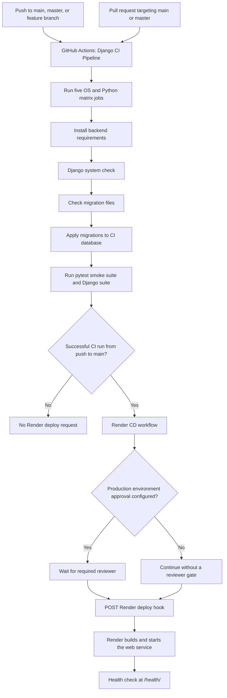

# CI/CD Pipeline Guide

Reference for demonstrating the Project Management System's continuous integration and deployment pipeline. The workflow definitions are in `.github/workflows/tests.yml` and `.github/workflows/deploy-render.yml`.

## 1. What CI/CD means in this project

- **Continuous Integration (CI)** runs the Django checks, migration checks, database setup, pytest smoke tests, and Django test suite on GitHub Actions when code is pushed or a pull request is opened.
- **Continuous Deployment (CD)** asks Render to deploy the `main` branch after CI succeeds. GitHub can pause this request for approval when the `production` environment is configured with required reviewers.

The CI job validates code on GitHub-hosted machines. It does not use or modify the production database. Render builds and runs the application separately.

## 2. Pipeline at a glance



## 3. Continuous Integration workflow

The workflow is named **Django CI Pipeline**. It is defined in `.github/workflows/tests.yml`.

### When it runs

- On a push to **any** branch.
- On a pull request whose target branch is `main` or `master`.

For example, pushing to `feature/task-table` runs CI. Opening a pull request from that branch into `main` runs CI again against the pull request. If you push again to the same branch while a run is still going, the older run is cancelled (`concurrency` with `cancel-in-progress`), so only the latest commit is tested.

### Test matrix

GitHub runs five independent job variants:

| Runner | Python |
| --- | --- |
| Ubuntu | 3.11 |
| Ubuntu | 3.12 |
| Ubuntu | 3.13 |
| Windows | 3.13 |
| macOS | 3.13 |

This checks compatibility across the supported Python versions and the three operating systems represented in the matrix. `fail-fast: false` lets every variant finish even if one fails, so the log shows exactly which combinations are broken. A successful pipeline means every matrix job, plus the coverage job, completed successfully.

### Steps in each job

1. **Check out repository code** with `actions/checkout@v5`.
2. **Install Python** with `actions/setup-python@v6`. Pip caching uses `backend/requirements-dev.txt` as its dependency key.
3. **Install dependencies** from `backend/requirements-dev.txt`. It includes the runtime requirements plus pytest, pytest-django, pytest-env, and coverage.
4. **Run `python manage.py check`** to catch Django configuration and model/system issues.
5. **Run `python manage.py makemigrations --check --dry-run`** to fail if model changes need migration files that were not committed. `--dry-run` means this check does not create a migration file.
6. **Run `python manage.py migrate --noinput`** to verify the committed migration chain can be applied in CI.
7. **Run `python -m pytest -v`** from the repository root. This runs the four native pytest functions in `backend/pytest_tests/` with pytest-django.
8. **Run `python manage.py test tests -v 2`** from `backend/`. This runs the existing Django `TestCase` suite with Django's built-in test runner.

The check and migration commands invoke `backend/manage.py`, which defaults to development settings when no override is provided. `manage.py test` automatically uses `config/test_settings.py`, which swaps in a fast password hasher so the suite runs in seconds instead of ~10 minutes (production still uses PBKDF2; `test_password_uses_pbkdf2_hasher` verifies this). In CI, that means Django uses a temporary SQLite database and a generated development secret key. Pytest uses the same Django settings through `pytest.ini` and pytest-django. The runner database is isolated from Render's production PostgreSQL database.

### Coverage job

After all five test jobs pass, a sixth job (**Code & branch coverage**) reruns the Django suite under `coverage` with branch measurement enabled (`backend/.coveragerc`). It:

- prints the statement + branch coverage table in the run's **Summary** tab, and
- uploads an artifact named **coverage-report** (HTML report + `coverage.xml`), kept for 30 days.

### What CI does not currently do

The workflow does **not** run a separate linter, static type checker, security scanner, or frontend build. Describe the actual checks above during the demo.

## 4. Continuous Deployment workflow

The workflow is named **Render CD** and is defined in `.github/workflows/deploy-render.yml`.

It listens for completion of **Django CI Pipeline** on `main`. It starts the deployment job only when all of these are true:

1. The completed CI workflow concluded with `success`.
2. The original event was a `push` (not a pull request).
3. The pushed branch was `main`.

Therefore, a successful feature-branch build or pull-request build does not deploy. A successful push to `master` also does not deploy through this workflow; the deployment branch is specifically `main`.

The deployment job uses the GitHub environment named `production`. It reads the environment secret `RENDER_DEPLOY_HOOK_URL` and sends it an HTTP `POST`. If that secret is missing, the workflow exits with a clear error. The concurrency group prevents overlapping Render deploy requests, and `cancel-in-progress: false` means a queued deployment is not canceled just because another run starts.

### Approval gate

The YAML selects the `production` environment, but **a manual approval is only required if GitHub's `production` environment has required reviewers configured**. Configure that under the repository's Settings → Environments → `production` → Protection rules. Without required reviewers, the job continues without a human approval step.

The secret `RENDER_DEPLOY_HOOK_URL` must be stored in that environment. It is a credential: never paste its value into a commit, issue, or demonstration slide. The workflow checks that it receives an HTTP success response from the hook. If the environment **variable** `PRODUCTION_URL` is set (for example `https://pms-web-gall.onrender.com`), a second step polls `PRODUCTION_URL/health/` for up to 15 minutes and fails the deployment job if the new release never reports healthy.

### One-time setup (admin)

1. **Render** → the web service → *Settings* → **Auto-Deploy: Off** (otherwise Render deploys every push, even when CI fails), then copy the **Deploy Hook** URL.
2. **GitHub** → *Settings* → *Environments* → `production`:
   - add secret `RENDER_DEPLOY_HOOK_URL` = the deploy hook URL,
   - add variable `PRODUCTION_URL` = the public site URL,
   - optionally add *Required reviewers* for a manual approval gate.

## 5. What Render does

The Render configuration is recorded in [`render.yaml`](../render.yaml) (a Render Blueprint) and summarised in the README. The web service uses `backend` as its root directory, with these commands:

```sh
# Build command
python -m pip install -r requirements.txt && python manage.py collectstatic --noinput

# Start command
python manage.py migrate --noinput && python -m gunicorn config.wsgi:application --bind 0.0.0.0:$PORT
```

Render installs the Python dependencies and collects static assets during the build. At startup, it applies database migrations and launches the Django WSGI application through Gunicorn. The `/health/` endpoint is the configured health-check path and checks application/database health.

Production settings are supplied through Render environment variables, including `DJANGO_DEBUG=false`, `DJANGO_SECRET_KEY`, `DJANGO_ALLOWED_HOSTS`, and PostgreSQL's `DATABASE_URL`. With debug disabled, the app requires `DATABASE_URL` and does not silently fall back to SQLite. Static files are served with WhiteNoise. Uploaded attachments need persistent storage or durable object storage because Render's ordinary service filesystem is ephemeral.

## 6. How to demonstrate it

1. Open the repository's **Actions** tab and select **Django CI Pipeline**.
2. Open a completed run and show the five matrix jobs.
3. Open one job and walk through dependency installation, Django checks, migration validation, migrations, and tests.
4. Explain that feature and pull-request runs validate changes, while only a successful push to `main` qualifies for the Render CD workflow.
5. Open **Render CD** to show the gated deployment job. If the environment uses required reviewers, show the approval gate without exposing the deploy-hook secret.
6. In Render, show the build/start logs and the healthy `/health/` result after deployment.

### Short explanation for the presentation

> “When code is pushed or a pull request targets our main branches, GitHub Actions installs the backend dependencies and checks Django migrations and tests across Python versions and operating systems. Only a successful push to `main` triggers the Render deployment workflow. That workflow calls a protected Render deploy hook, optionally waits for production-environment approval, and Render then builds the app, applies migrations, and starts it with Gunicorn. We confirm the live deployment with Render's health check.”

## 7. Running the CI checks locally

From the repository root, the equivalent Django commands are:

```sh
cd backend
python manage.py check
python manage.py makemigrations --check --dry-run
python manage.py migrate --noinput
python manage.py test tests -v 2

# coverage (statement + branch), same as the CI coverage job
python -m coverage run manage.py test tests
python -m coverage report
python -m coverage html   # open backend/htmlcov/index.html
```

These local commands use the database configured for the local environment. In the default development setup this is SQLite; do not point local verification at production unless that is intentional and authorized.

## 8. Common failures

| Symptom | What to inspect |
| --- | --- |
| Dependency installation fails | Confirm `backend/requirements.txt` is current and compatible with the selected Python version. |
| Django system check fails | Read the first Django error in the job log; verify settings, imports, and environment assumptions. |
| Migration check fails | Create and commit the missing migration, then rerun CI. |
| Migration application fails | Check migration dependencies and whether a migration assumes data/schema that is not available in a clean database. |
| Tests fail | Read the failing test name and traceback; reproduce with `python manage.py test tests -v 2`. |
| Render CD reports missing `RENDER_DEPLOY_HOOK_URL` | Add the deploy hook URL as a secret on the GitHub `production` environment. |
| Site changes even though CI failed | Render auto-deploy is still on. Set Auto-Deploy to Off so only the Render CD workflow deploys. |
| Render CD health check fails | The deploy was requested but `/health/` never returned 200; open the Render deploy logs. |
| CI succeeds but Render is not healthy | Check Render build/start logs, environment variables, database connectivity, migrations, and `/health/`. The webhook response only confirms the request was accepted. |

