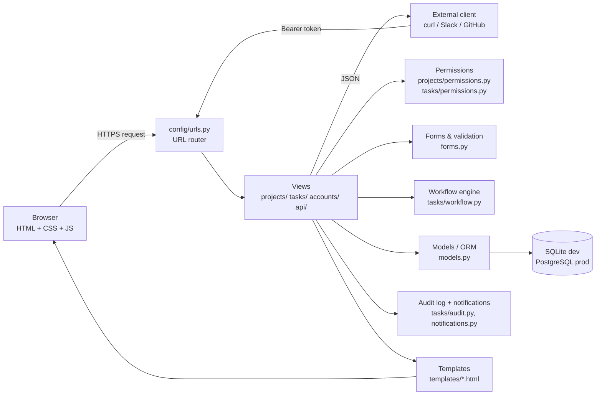
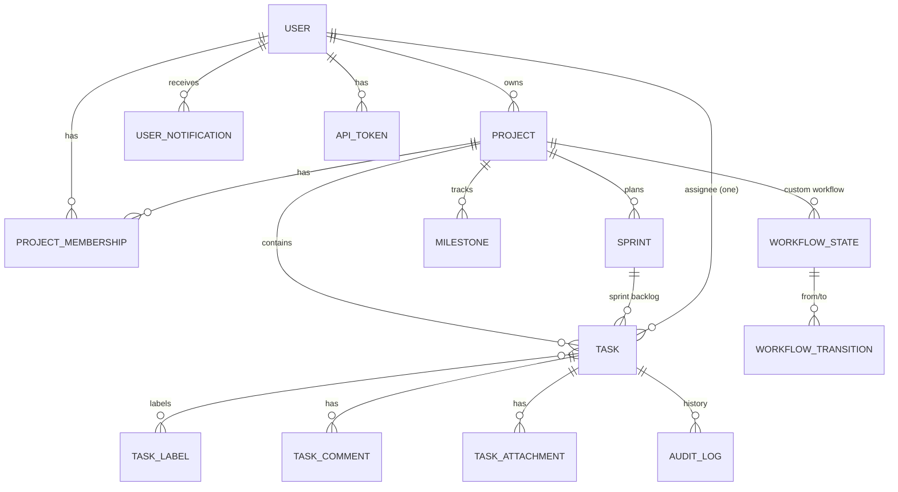
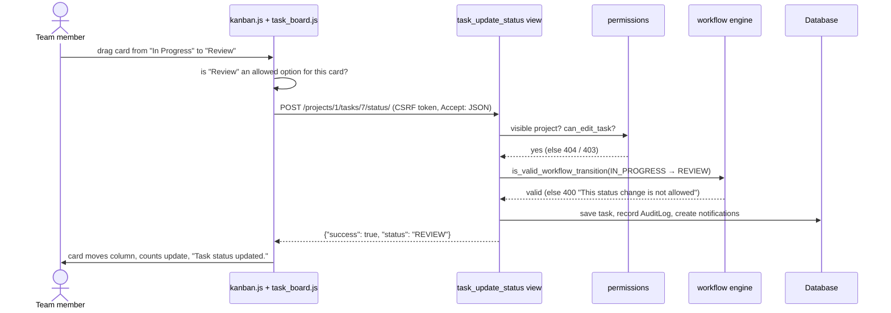

# PMS — Project Walkthrough & Viva Guide (Team 11)

One document to understand the whole Project Management System: what it does, how it is built, how a request flows through it, how it is tested and deployed, and the questions we are likely to be asked in the viva.

> Live site: https://pms-web-gall.onrender.com · Repo: `Project-Management-System-SE` · Board: GitHub Projects → *Sprint Tracking* (Sprints 1–3, 46 items, all Done)

---

## 1. The project in one minute

**PMS** is a web app (a small Jira/Trello) where teams **create projects, add members, create tasks, move them across a Kanban board, plan sprints, estimate effort, and see dashboards and reports**.

| | |
|---|---|
| **Stack** | Python 3.11–3.13, **Django 5.1** (MVT pattern), Django templates + vanilla JavaScript, SQLite (local/tests) / **PostgreSQL** (production) |
| **Users / roles** | **Admin** (superuser/staff), **Project Manager** (per project), **Team Member** (per project) |
| **Key rule** | A task **cannot go to Done unless it is in Review** (or a QA/Review state in a custom workflow) |
| **Interfaces** | Web UI (HTML) + documented **REST API** `/api/v1/` (OpenAPI spec + docs page) |
| **Quality** | 354 Django tests + 4 pytest tests, CI on 5 OS/Python combos, ~84% statement / 66% branch coverage |
| **Deployment** | GitHub Actions CI → Render CD (Gunicorn + WhiteNoise + PostgreSQL) |

---

## 2. Architecture

The app follows Django's **MVT (Model–View–Template)** pattern — the SRS constraint "MVC/MVT" (§2.5).



- **Model** = data + business rules (`models.py`, e.g. `Task.clean()` validation).
- **View** = request handling: check login → check permission → validate form → save → audit → notify → render.
- **Template** = HTML in `templates/` that extends `base.html` (sidebar, breadcrumbs, help dialog).

### Folder map

```text
backend/
  config/      settings.py (env-based config), urls.py, health.py (/health/), test_settings.py
  accounts/    custom User (login by email), registration, email confirmation, People admin page
  projects/    Project, Membership, Sprint, Milestone; dashboard, reports, burndown/velocity analytics
  tasks/       Task, WorkflowState/Transition, Label, Comment, Attachment, AuditLog, Notification
  api/         REST API v1: token auth, throttling, OpenAPI docs
  tests/       354 Django tests (33 modules)
  pytest_tests/ 4 pytest smoke tests
templates/     all HTML pages        static/  css/style.css, js/app.js, kanban.js, task_board.js
docs/          SRS, test plan, architecture, this guide, TESTING_GUIDE, CI_CD_PIPELINE_GUIDE
.github/workflows/  tests.yml (CI) and deploy-render.yml (CD)      render.yaml (deployment config)
```

---

## 3. Data model



| Model | Important fields / rules |
|---|---|
| `User` (accounts) | Custom user, **login with email** (`USERNAME_FIELD = "email"`), `full_name`; `is_admin` = superuser/staff |
| `Project` | name, description, status (Planned/Active/On Hold/Completed/Archived), start/due date, owner |
| `ProjectMembership` | user + project + role (**Project Manager** / **Team Member**), unique per pair |
| `Task` | title, description, **priority** (Low/Medium/High/Critical), **status** (Backlog/To Do/In Progress/Review/Done), due date, **one assignee**, labels, **estimated_effort / actual_effort**, sprint, milestone, `completed_at` |
| `Sprint` / `Milestone` | start/end dates, status; closing a sprint carries unfinished tasks over (`SprintTaskHistory`) |
| `WorkflowState` / `WorkflowTransition` | per-project custom columns and allowed moves |
| `AuditLog` | actor, action (Create/Update/Delete), object, changes, timestamp — **immutable** |
| `UserNotification`, `TaskDueReminder` | in-app inbox, one reminder per task per due date |
| `APIToken` | key for `Authorization: Bearer <token>` API access |

---

## 4. Roles & permissions (RBAC)

Defined in `projects/permissions.py` and `tasks/permissions.py`, checked **on the server in every view and API endpoint** (hiding a button is never the only protection).

| Action | Admin | Project owner / PM | Team member (of the project) | Outsider |
|---|:-:|:-:|:-:|:-:|
| See project & tasks | ✅ | ✅ | ✅ | ❌ 404 |
| Create project | ✅ | ✅ (is a PM somewhere) | ❌ | ❌ |
| Edit / archive / delete project, manage members | ✅ | ✅ | ❌ 403 | ❌ |
| Create task, edit task, move task on board | ✅ | ✅ | ✅ | ❌ |
| Reassign or delete task | ✅ | ✅ | ❌ 403 | ❌ |
| Configure workflow, plan/close sprints | ✅ | ✅ | ❌ 403 | ❌ |
| View reports & download CSV | ✅ | ✅ | ✅ (link shown to PMs only) | ❌ |

Outsiders get **404 (not 403)** so they cannot even learn that a project exists.

---

## 5. How a request flows — example: dragging a card on the Kanban board



Without JavaScript the same form submits normally and the page reloads — the board still works (progressive enhancement).

---

## 6. Features → SRS requirements → where in the code → how to demo

| SRS | Feature | Code | Demo |
|---|---|---|---|
| FR1.1–1.2 | Register (name/email/password), email confirmation, login by email, 30-day session | `accounts/views.py`, `accounts/forms.py`, `accounts/tokens.py` | Register → confirm link printed in console (dev) → log in |
| FR1.3 | Roles: Admin / PM / Team Member | `projects/permissions.py`, `tasks/permissions.py`; People page `accounts/views.py:people_management` | Log in as member → no Edit/Delete project buttons; direct URL → 403 |
| FR1.4 | Password reset by time-limited email link (24 h) | Django auth views + `PASSWORD_RESET_TIMEOUT` | "Forgot password?" |
| FR2.1–2.3 | Create / edit / archive / delete project; add/remove members (notified) | `projects/views.py`, `projects/forms.py` | Project page → Danger zone (asks for confirmation) |
| FR3.1–3.3 | Tasks with title, description, priority, due date, labels; one assignee | `tasks/models.py:Task`, `tasks/forms.py`, `tasks/views.py` | Create task; assignee list only shows project members |
| FR4.1–4.3 | Kanban columns, drag-and-drop, invalid moves rejected | `templates/task_list.html`, `static/js/kanban.js`, `task_board.js`, `tasks/views.py:task_update_status` | Board → drag To Do → Done ⇒ rejected |
| FR5.1–5.3 | Custom workflow states & transitions per project | `tasks/workflow.py`, `tasks/workflow_forms.py`, `tasks/models.py:WorkflowState/Transition` | Project → Configure workflow |
| FR6.1–6.3 | Estimate & actual effort, estimated vs actual per task and sprint | `Task.estimated_effort/actual_effort`; dashboard & list "Estimate / Actual" | Task list column, dashboard project card |
| FR7.1–7.3 | Sprints & milestones, sprint backlog, close sprint with carry-over | `projects/models.py:Sprint`, `projects/views.py` (sprint close), `SprintTaskHistory` | Planning → sprint → Close (choose carry-over target) |
| FR8.1–8.4 | Dashboard: progress, burndown, velocity, distribution by status & assignee | `projects/views.py:dashboard`, `projects/analytics.py` | Dashboard → Sprint Analytics, Tasks by assignee |
| FR9.1–9.3 | Notifications: assignment, status change, comment, due-date reminder | `tasks/notifications.py`, `config/notifications.py`, command `send_due_date_reminders` | Assign a task → assignee's Inbox |
| FR10.1–10.3 | Comments (chronological, author, time) & file attachments (type/size checked) | `TaskComment`, `TaskAttachment`, `tasks/views.py` | Task page → Comments / Attachments |
| FR11.1–11.3 | Keyword search + filters (assignee, priority, status, label, sprint), combinable | `tasks/forms.py` filter form, `tasks/views.py:task_list` | Task list → filters |
| FR12.1–12.3 | Progress, velocity, workload reports (page with charts + CSV) | `projects/reports.py`, `templates/project_reports.html` | Project → Project Reports → Export CSV |
| FR13.1–13.3 | Activity log of create/update/delete, per task & project, kept for project lifetime | `tasks/audit.py:record_audit`, `tasks/models.py:AuditLog` | Project → Activity history; task page → Task activity |
| NFR9 | REST API for integrations | `api/` (`/api/v1/docs/`, `/api/v1/openapi.json`) | Open `/api/v1/docs/` |
| NFR8 | Backups | command `backup_database` (DB fixture + uploaded media → zip) | `python manage.py backup_database` |

---

## 7. Key logic you should be able to explain

**Review-before-Done rule (SRS §6.5).** `tasks/workflow.py` holds the default transition map:

```text
Backlog → To Do → In Progress → Review → Done
          ↑ back to Backlog   ↑ back to To Do  ↑ back to In Progress   Done → Review (reopen)
```

For custom workflows, `is_review_state()` treats a state as "review" if its key/name is Review / In Review / QA / Quality Assurance. The final state can only be reached **from** a review state — enforced when the workflow is saved *and* on every move (web and API).

**Burndown (`projects/analytics.py:build_sprint_burndown`).** Total = sum of estimated effort of the sprint's tasks. *Ideal* line falls linearly from total to 0 between sprint start and end. *Actual* line subtracts each Done task's estimate on the date it was completed (`completed_at`). Limitation: we only know current Done tasks' completion dates (no full daily history) — the page says this honestly.

**Velocity.** Sum of estimated effort of Done tasks in a **completed** sprint. If any completed task has no estimate, velocity is shown as incomplete instead of a misleading number. Average velocity = mean over completed sprints with complete estimates.

**Sprint close & carry-over (FR7.3).** On close, unfinished tasks move to the chosen next sprint or back to the backlog; each move is recorded in `SprintTaskHistory` with a reason.

**Audit log (FR13).** `record_audit(actor, action, obj, changes)` is called by views after create/update/delete; it stores a snapshot so deleted items still have history. Entries are never edited.

**Notifications (FR9).** On assignment, status change and comment, `create_notifications()` writes in-app notifications for the relevant people (not the actor). `send_due_date_reminders` (schedule daily) notifies assignees of tasks due tomorrow, once per task/date.

**REST API.** `api/auth.py:api_auth_required` accepts **Bearer/Token API keys** or the browser session (session writes need CSRF). `api/throttling.py` limits **120 reads / 30 writes per minute** per user/IP (HTTP 429 with `Retry-After`). Lists are paginated and filterable; errors use one JSON format.

---

## 8. Security (NFR3) — what protects what

| Threat | Protection |
|---|---|
| Password theft | Passwords **hashed with PBKDF2-SHA256** (Django default, salted, many iterations) — never stored or logged in plain text |
| SQL injection | Django ORM uses parameterised queries — no raw SQL string building |
| XSS | Templates auto-escape output; task titles with HTML/script tags are rejected by validation |
| CSRF | `CsrfViewMiddleware` + `` on every form; API session writes require the token |
| Clickjacking / sniffing | `X-Frame-Options: DENY`, `nosniff`, secure referrer policy |
| HTTPS | Production: SSL redirect, HSTS (1 year), secure + HttpOnly cookies, proxy SSL header for Render |
| Unauthorised access | Server-side permission checks; outsiders get 404 |
| Secrets | Read from environment variables (`.env.example`), never committed; app refuses to start in production without `DJANGO_SECRET_KEY` and `DATABASE_URL` |
| Spreadsheet formula injection | CSV report cells starting with `= + - @` are escaped |

`python manage.py verify_production_security` checks these settings.

---

## 9. Frontend

- Server-rendered **Django templates**; every page extends `templates/base.html` (sidebar navigation, top bar, **breadcrumbs**, **help (?) dialog**, **confirmation dialog** for destructive actions — SRS §3.1).
- **Design system** in `static/css/style.css`: Carbon-style light theme (Gray 10 background, white layers, Blue 60 actions, IBM Plex Sans), optional dark mode (moon icon), responsive off-canvas sidebar for tablets/phones (NFR4).
- **JavaScript** (no framework): `app.js` (theme, mobile menu, dialogs), `kanban.js` (drag-and-drop), `task_board.js` (AJAX status updates with error messages).
- Accessibility: skip link, ARIA labels, keyboard focus outlines, hidden data tables behind charts.

---

## 10. Testing

| What | Numbers |
|---|---|
| Django tests (`backend/tests/`) | **354** test methods in 33 modules — models, forms, views, permissions, workflow, API, security, reports |
| Pytest smoke tests (`backend/pytest_tests/`) | **4** |
| Coverage (statements) | **83.8%** (3118 / 3722 lines) |
| Coverage (branches) | **66.0%** (797 / 1208 branches) |

- **Statement coverage** = % of code lines executed by tests. **Branch coverage** = % of `if/else` outcomes taken (both the true and false path) — stricter, which is why it is lower.
- Tests are **unit** (models, workflow functions) and **integration** (Django test client: URL → view → DB → template) — not browser end-to-end.
- Tests use `config/test_settings.py` (fast password hasher) → full suite in ~20 s instead of ~10 min; a test still checks production uses PBKDF2.

```bash
cd backend
python manage.py test tests                 # all Django tests
cd .. && python -m pytest -v                 # pytest smoke tests
cd backend && python -m coverage run manage.py test tests && python -m coverage report && python -m coverage html
```

Details: [`TESTING_GUIDE.md`](TESTING_GUIDE.md).

---

## 11. CI/CD and deployment

```mermaid
flowchart LR
    A[git push] --> B[Django CI Pipeline<br/>tests.yml]
    B --> C{5 jobs:<br/>Ubuntu 3.11/3.12/3.13,<br/>Windows 3.13, macOS 3.13}
    C -->|check, migrations,<br/>pytest, Django tests| D[Coverage job<br/>report + HTML artifact]
    D -->|all green AND push to main| E[Render CD<br/>deploy-render.yml]
    E -->|POST deploy hook| F[Render builds:<br/>pip install, collectstatic]
    F --> G[Start: migrate,<br/>gunicorn]
    G --> H[/health/ = 200 ✓]
```

- **CI** runs on every push and PR: `manage.py check` → `makemigrations --check` → `migrate` → pytest → Django tests, on 5 OS/Python combinations; then a coverage job.
- **CD** runs only when CI passed for a push to `main`; it calls Render's deploy hook (secret `RENDER_DEPLOY_HOOK_URL` in the GitHub `production` environment) and waits for `/health/`.
- **Render**: root `backend`, build `pip install -r requirements.txt && collectstatic`, start `migrate && gunicorn config.wsgi`, PostgreSQL via `DATABASE_URL`, static files via **WhiteNoise**. Config recorded in `render.yaml`.

Details: [`CI_CD_PIPELINE_GUIDE.md`](CI_CD_PIPELINE_GUIDE.md).

---

## 12. Run it locally

```bash
python -m venv venv && venv\Scripts\activate         # Windows (source venv/bin/activate on Linux/macOS)
pip install -r backend/requirements-dev.txt
python backend/manage.py migrate
python backend/manage.py createsuperuser             # admin account
python backend/manage.py runserver                   # http://127.0.0.1:8000
```

Emails (confirmation, password reset) print in the terminal in development.

---

## 13. Who did what (from the GitHub board)

| Member | Main contributions |
|---|---|
| **Shivansh Sharma** (`shivanshpap`) | Repo setup, CI/CD pipeline, task permissions & validation, configurable workflows, downloadable reports, REST API + docs, production database & security config |
| **Shibi R Shetty** (`shibishetty77`) | Architecture, DB schema, project creation, backend foundation, board interaction, task list/board UI, labels & validation, comments & attachments, search & filters, burndown & velocity, REST API v1 expansion, end-to-end review |
| **Sheetal S Bevinakatti** (`sheetalbevinakatti`) | Frontend foundation & UI redesign, unit & integration tests, task views & status updates, registration/password reset/email confirmation, project editing & membership, notifications, performance & cross-platform checks, Render deployment, CI/CD repair & coverage |
| **Shivanagouda I Patil** (`shivanagouda19`) | Requirements analysis, documentation, task model & forms, dashboard & distribution, estimates & effort tracking, sprint/milestone lifecycle, audit log, backup & recovery |

---

## 14. Likely viva questions — with answers

**Q1. Why Django?** Batteries included: ORM (SQL-injection safe), auth, admin, forms, CSRF protection, migrations, test framework; it naturally gives the MVT structure the SRS asks for.

**Q2. What is MVT and where is each part?** Model = `models.py` (data + rules), View = `views.py` (request logic), Template = `templates/*.html`. URLs in `urls.py` map a request to a view.

**Q3. How do you enforce "Review before Done"?** In `tasks/workflow.py`: Done (or the final custom state) is only an allowed target from a review/QA state. Checked on every web and API move (HTTP 400 otherwise) and when a PM saves a custom workflow.

**Q4. How does drag-and-drop work?** HTML5 drag events in `kanban.js` pick the target column, set the hidden status form and submit it; `task_board.js` sends it with `fetch` and moves the card only after the server confirms. The server re-checks permission and workflow — the browser is never trusted.

**Q5. How is RBAC implemented?** Global admin flag on the user + per-project role in `ProjectMembership`. Permission functions (`can_manage_project`, `can_edit_task`, …) are called in every view/API endpoint.

**Q6. Why 404 instead of 403 for outsiders?** So people cannot discover which projects exist (information hiding).

**Q7. How are passwords stored?** Salted PBKDF2-SHA256 hashes (Django default). The SRS example says bcrypt; PBKDF2 is equally standard and recommended by Django/NIST. Plain passwords are never stored or logged.

**Q8. How do you prevent SQL injection / XSS / CSRF?** ORM parameterised queries / template auto-escaping + input validation / CSRF middleware and tokens.

**Q9. Explain burndown and velocity.** Burndown = remaining estimated effort over the sprint (ideal straight line vs actual based on completion dates). Velocity = estimated effort of Done tasks in a completed sprint.

**Q10. What happens when a sprint is closed?** Unfinished tasks are carried to the selected sprint or backlog, recorded in `SprintTaskHistory`, and velocity becomes final.

**Q11. How do notifications work?** Events (assign, status change, comment) create `UserNotification` rows for relevant users; due-date reminders come from a scheduled management command. In-app inbox; email via SMTP settings.

**Q12. How does the REST API authenticate and limit usage?** Bearer API tokens (or session + CSRF), per-user/IP rate limit (120 reads, 30 writes per minute → 429), pagination and filters, OpenAPI 3 spec at `/api/v1/openapi.json`.

**Q13. How is the activity log tamper-resistant?** Entries are only created, never updated from the app; they keep snapshots even after deletion. (A DB admin could still change rows — production could use append-only storage.)

**Q14. What is the difference between statement and branch coverage? Your numbers?** Lines executed vs decision outcomes executed. ~84% statements, 66% branches.

**Q15. What kinds of testing did you do?** Unit, integration (Django test client), security tests (permissions, CSRF, XSS input, hashing, headers), regression in CI on 5 platforms. Manual acceptance on the live site. No browser automation (Selenium) yet.

**Q16. Explain your CI/CD pipeline.** See §11: push → 5-job CI + coverage → if green on `main`, CD triggers Render deploy hook → build, migrate, gunicorn → health check.

**Q17. Why does the test suite use a different password hasher?** Hashing 300+ test users with production-strength PBKDF2 took ~10 minutes; tests use a fast hasher only in `test_settings.py`. A dedicated test verifies production still uses PBKDF2.

**Q18. Why SQLite locally and PostgreSQL in production?** SQLite needs no setup for development/tests; PostgreSQL handles concurrent users and is Render's managed DB. `DATABASE_URL` switches between them; production refuses to fall back to SQLite.

**Q19. How do you serve static files in production?** `collectstatic` + WhiteNoise (compressed, cache-busted file names) inside Gunicorn — no separate web server needed.

**Q20. How are uploads validated?** Allowed extensions and max size (10 MB, `TASK_ATTACHMENT_MAX_SIZE_BYTES`); downloads go through a permission-checked view.

**Q21. How do backups work (NFR8)?** `python manage.py backup_database` writes a zip with a DB fixture, a manifest and uploaded media; it can be scheduled.

**Q22. What would you improve next?** Real-time board updates (WebSockets), Slack/GitHub webhooks, browser E2E tests (Selenium/Playwright), higher branch coverage, persistent object storage for attachments, full daily burndown history.

---

## 15. Honest limitations (say these confidently if asked)

- No WebSockets: other users see board changes after refresh (SRS allows "short-interval polling" as an option; not implemented).
- Slack/GitHub integrations are possible **through the REST API**, but no built-in webhooks.
- Burndown "actual" line is reconstructed from completion dates, not a daily snapshot.
- Uploaded attachments on Render's free tier are on an ephemeral disk (use object storage for real production).
- Branch coverage 66% — tested heavily on main paths, fewer error/edge branches.
