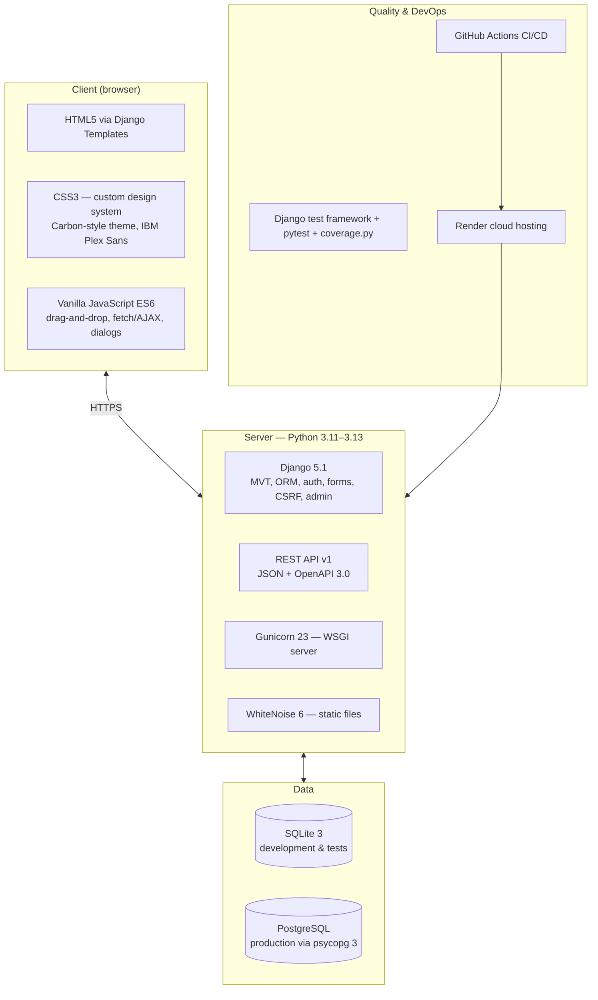

# Tech Stack — PMS (Team 11)

Every technology used to build, test and run the Project Management System, the exact version, where it is used in the repository, and why we chose it.

---

## 1. At a glance

| Layer | Technology | Version |
|---|---|---|
| Language (backend) | **Python** | 3.11, 3.12, 3.13 (developed on 3.12.7) |
| Web framework | **Django** | 5.1.15 |
| Frontend | **HTML5 + Django Template Language**, **CSS3**, **vanilla JavaScript (ES6)** | — |
| Font | **IBM Plex Sans** (Google Fonts, open licence) | — |
| Database (dev/test) | **SQLite 3** | bundled with Python |
| Database (production) | **PostgreSQL** (managed by Render) | via psycopg 3.3 |
| DB URL parsing | **dj-database-url** | 2.3.0 |
| Application server | **Gunicorn** | 23.0.0 |
| Static files in production | **WhiteNoise** | 6.12.0 |
| API | **Django views returning JSON**, **OpenAPI 3.0** spec, token auth, rate limiting | in-house (`backend/api/`) |
| Testing | **Django test framework (unittest)**, **pytest** 8.4, **pytest-django** 4.14, **pytest-env** 1.2, **coverage.py** 7.17 | — |
| CI/CD | **GitHub Actions** | `tests.yml`, `deploy-render.yml` |
| Hosting | **Render** (web service + PostgreSQL) | `render.yaml` |
| Version control & planning | **Git**, **GitHub**, **GitHub Projects** (Sprint Tracking board, Sprints 1–3) | — |
| Editor | **Visual Studio Code** | — |

Runtime dependencies are only five packages — `backend/requirements.txt`; test tools are in `backend/requirements-dev.txt`.

---

## 2. Backend

### Python
- Main language for all server code, tests and scripts.
- CI checks compatibility with **Python 3.11, 3.12 and 3.13**.

### Django 5.1 (web framework)
We use Django's built-in features instead of extra libraries:

| Django feature | What we use it for | Where |
|---|---|---|
| **MVT architecture** | Models (data), Views (logic), Templates (HTML) — the SRS "MVC/MVT" constraint | `backend/*/models.py`, `views.py`, `templates/` |
| **ORM** | All database access; prevents SQL injection; same code works on SQLite and PostgreSQL | `models.py`, queries in views |
| **Migrations** | Versioned database schema changes | `backend/*/migrations/` |
| **Authentication** | Custom `User` model (login by email), sessions, password hashing (PBKDF2), password reset with signed tokens | `backend/accounts/` |
| **Forms** | Server-side validation of all user input | `forms.py` in each app |
| **Security middleware** | CSRF protection, clickjacking (`X-Frame-Options`), HTTPS redirect, HSTS, secure cookies | `backend/config/settings.py` |
| **Admin site** | Built-in admin for superusers | `/admin/`, `admin.py` |
| **Management commands** | `backup_database`, `send_due_date_reminders`, `check_db_connection`, `verify_production_security` | `backend/*/management/commands/` |
| **Email** | Registration confirmation, password reset, notifications (console in dev, SMTP in production) | `EMAIL_*` settings |
| **Messages framework** | Success/error banners after actions | `templates/base.html` |

### Our Django apps (modules)

| App | Responsibility |
|---|---|
| `config` | Settings (environment-variable based), root URLs, `/health/` check, WSGI entry point, test settings |
| `accounts` | Custom user, registration + email confirmation, login, password reset, admin People page |
| `projects` | Projects, memberships & roles, sprints, milestones, dashboard, reports, burndown/velocity analytics |
| `tasks` | Tasks, labels, workflow states/transitions, comments, attachments, audit log, notifications |
| `api` | REST API v1: token authentication, throttling, pagination, OpenAPI docs |

### REST API (built in-house, no extra framework)
- JSON endpoints under **`/api/v1/`** written as Django views (`backend/api/views.py`).
- **Authentication:** `Authorization: Bearer <token>` (model `APIToken`) or browser session + CSRF.
- **Rate limiting:** 120 reads / 30 writes per minute per user (Django cache), returns HTTP 429.
- **Documentation:** **OpenAPI 3.0** specification at `/api/v1/openapi.json` and a docs page at `/api/v1/docs/`.
- Why not Django REST Framework? The API is small; plain Django views kept dependencies minimal and let us reuse the same permission functions as the web pages.

### Gunicorn + WhiteNoise (production serving)
- **Gunicorn** runs the Django WSGI app (`config.wsgi:application`) on Render.
- **WhiteNoise** serves CSS/JS directly from Gunicorn with compression and cache-busting file names (`CompressedManifestStaticFilesStorage`) — no separate Nginx needed.

---

## 3. Frontend

| Technology | Use |
|---|---|
| **HTML5** + **Django Template Language** | Server-rendered pages; every page extends `templates/base.html` (sidebar, top bar, breadcrumbs, help and confirmation dialogs) |
| **CSS3** (one file, `static/css/style.css`) | Custom design system: CSS custom properties (design tokens), Grid and Flexbox layouts, responsive media queries, light theme + optional dark mode |
| **Carbon-style design** | Look based on the open Carbon Design System guidelines: Gray 10 background, white layers, Blue 60 (`#0f62fe`) actions, square corners, 2px focus outlines |
| **IBM Plex Sans** | Typeface (loaded from Google Fonts, falls back to system fonts) |
| **Vanilla JavaScript (ES6)** — no framework | `app.js` (theme toggle, mobile sidebar, help/confirm `<dialog>`), `kanban.js` (HTML5 drag-and-drop), `task_board.js` (`fetch` AJAX status updates with JSON responses) |
| **Inline SVG** | Icons and the burndown chart (no chart library); bar charts are pure CSS |
| **Accessibility** | Skip link, ARIA labels/live regions, keyboard focus, screen-reader data tables behind charts |

Why no React? The SRS allowed Django templates or MERN; server-rendered templates keep one language/codebase, need no build step, and work without JavaScript (forms still submit), while small scripts add drag-and-drop and live updates.

---

## 4. Database

| Environment | Database | How it is selected |
|---|---|---|
| Development & tests | **SQLite 3** (file `db.sqlite3`; tests use a temporary DB) | default when `DJANGO_DEBUG=true` |
| Production (Render) | **PostgreSQL** (managed) | `DATABASE_URL` environment variable, parsed by **dj-database-url**, driver **psycopg 3** |
| Also supported by config | MySQL | `DJANGO_DB_ENGINE=mysql` (needs the `mysqlclient` driver, not installed by default) |

- Same models and migrations for every database (Django ORM).
- Production refuses to start without `DATABASE_URL` (no silent fallback to SQLite).
- Schema design: `docs/pms_database_schema_deliverables/` (ER diagram + PostgreSQL DDL).

---

## 5. Testing tools

| Tool | Use |
|---|---|
| **Django test framework** (built on Python `unittest`) | 354 tests in `backend/tests/` (`TestCase`, `SimpleTestCase`, test client) |
| **pytest** + **pytest-django** + **pytest-env** | 4 pytest tests in `backend/pytest_tests/` with `django_db` marker and `client` fixture; config in `pytest.ini` |
| **coverage.py** | Statement + branch coverage (`backend/.coveragerc`) — 83.8% / 66.0% |
| **Django test client** | Integration and black-box tests through real HTTP requests |

Details: [`TESTING_GUIDE.md`](TESTING_GUIDE.md).

---

## 6. DevOps, hosting and collaboration

| Tool | Use |
|---|---|
| **Git** | Version control (feature branches, pull requests, 170+ commits) |
| **GitHub** | Code hosting, pull requests and reviews |
| **GitHub Projects** | Agile board *Sprint Tracking*: issues, assignees, Sprint 1–3 iterations, Todo/In Progress/Done |
| **GitHub Actions** | **CI** (`tests.yml`): checks, migrations, pytest, Django tests on Ubuntu/Windows/macOS × Python 3.11–3.13, coverage report. **CD** (`deploy-render.yml`): deploys after CI passes on `main`, then checks `/health/` |
| **Render** | Cloud hosting: Python web service (build → `pip install` + `collectstatic`; start → `migrate` + `gunicorn`) and managed PostgreSQL; HTTPS certificate; config in `render.yaml` |
| **Environment variables** | All secrets and settings (`DJANGO_SECRET_KEY`, `DATABASE_URL`, email, security flags); template in `.env.example` |
| **Mermaid** | Diagrams inside Markdown docs (rendered by GitHub) |
| **VS Code** | Code editor |

Live site: **https://pms-web-gall.onrender.com**

---

## 7. Security technologies (built in)

| Need (SRS NFR3) | Technology |
|---|---|
| Password hashing | Django **PBKDF2-SHA256** (salted, many iterations) |
| HTTPS | Render TLS certificate + Django `SECURE_SSL_REDIRECT`, **HSTS**, secure/HttpOnly cookies, `SECURE_PROXY_SSL_HEADER` |
| CSRF | Django `CsrfViewMiddleware` + `` |
| XSS | Template auto-escaping + input validation |
| SQL injection | Django ORM parameterised queries |
| API abuse | Token auth + rate limiting (HTTP 429) |
| Signed links | Django signed tokens for email confirmation and 24-hour password reset |

---

## 8. Why this stack? (viva answers)

**Q: Why Django and not MERN?** The SRS allowed either. Django gives authentication, an ORM that blocks SQL injection, CSRF protection, migrations, forms, an admin panel and a test framework out of the box, so we could spend our time on project-management features. One language (Python) for the whole backend.

**Q: Why SQLite in development and PostgreSQL in production?** SQLite needs zero setup for development and fast tests; PostgreSQL is a robust multi-user database that Render manages for us. Django's ORM lets the same code run on both.

**Q: Why no frontend framework?** Server-rendered templates need no build tools, load fast, and still work without JavaScript. Drag-and-drop and AJAX status updates only needed ~280 lines of vanilla JavaScript.

**Q: Why Gunicorn and WhiteNoise?** Django's `runserver` is only for development. Gunicorn is a production WSGI server; WhiteNoise serves compressed static files from the same process, so no extra web server is needed on Render.

**Q: Why Render?** Free tier for a Python web service plus managed PostgreSQL, automatic HTTPS, deploy hooks for our CI/CD pipeline, and a `/health/` health check.

**Q: Why GitHub Actions?** Built into GitHub where our code already lives; free for public repos; runs on Linux, Windows and macOS so we test cross-platform compatibility (NFR7).

**Q: Why pytest as well as Django's test runner?** The main suite uses Django's built-in runner; pytest (with pytest-django) gives simpler function-style tests and fixtures — we use it for the smoke-test suite, and CI runs both.
