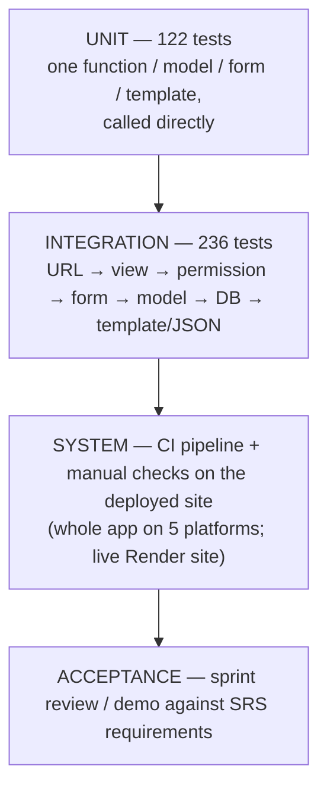

# Testing Guide — PMS (Team 11)

Everything about how the Project Management System is tested: how many test cases, which kinds (unit, integration, system), the pytest suite, white-box and black-box techniques, coverage, and how to run it all. Numbers below were produced from the code and a full test run on 19 Nov 2026.

---

## 1. Quick answers (for the viva)

| Question | Answer |
|---|---|
| How many test cases? | **358 automated test cases**: **354** Django tests + **4** pytest tests |
| How are they organised? | **34 test modules**, **48 test classes** (`backend/tests/` and `backend/pytest_tests/`) |
| Did they pass? | **Yes — 354/354 Django tests OK (~20 s) and 4/4 pytest tests passed** |
| Unit vs integration? | **122 unit tests** + **236 integration tests** (232 through HTTP requests, 4 through management commands) |
| Did you use pytest? | **Yes** — 4 pytest tests with `pytest-django` (`backend/pytest_tests/test_pms_smoke.py`) |
| White-box testing? | **Yes** — unit tests of internal functions/branches (workflow engine, burndown, velocity, permission predicates, model validation) + **statement and branch coverage** measurement |
| Black-box testing? | **Yes** — integration/API tests that only use inputs and outputs (HTTP requests → status codes, pages, JSON), designed with **equivalence partitioning, boundary value analysis, negative testing** |
| Code coverage? | **83.8% statement coverage**, **66.0% branch coverage** (79.4% combined) |
| Where do they run? | Locally and in **GitHub Actions CI** on 5 OS/Python combinations on every push, plus a coverage job |
| Tools | Django test framework (`unittest`), Django test client, **pytest + pytest-django + pytest-env**, **coverage.py**, GitHub Actions |

---

## 2. Test levels



### 2.1 Unit testing (122 tests)

A **unit test** calls one piece of code directly — a model method, a form, a permission function, the workflow engine, an analytics function or a template — and checks the result. No HTTP request is made.

| Module | Unit tests | What is tested directly |
|---|---:|---|
| `test_models.py` | 10 | `User.objects.create_user` hashes passwords, superuser flags, email as login ID, project date rules, unique membership |
| `test_forms.py` | 10 | `ProjectForm` required fields, name length, status choices, date boundaries |
| `test_workflow_transitions.py` | 6 | `is_valid_transition`, `validate_status_transition`, custom workflow, Review-before-Done |
| `test_task_permissions.py` | 5 | `can_view_tasks_for`, `can_create_task_in`, `can_edit_task`, `can_reassign_task`, `can_delete_task` |
| `test_task_validation.py` | 5 | `Task.full_clean()`: title length, XSS input, due date vs project start, assignee must be member |
| `test_reports_metrics.py` | 11 | progress %, velocity, average velocity, burndown ideal/actual, empty projects, CSV generation |
| `test_project_analytics.py` | 2 | `build_sprint_burndown`, completed-sprint velocity |
| `test_task_form_template.py` | 12 | task form template rendered directly (`SimpleTestCase`): values, errors, ARIA attributes |
| `test_tasks.py` | 27 | `Task`/`TaskLabel` models, effort fields, label de-duplication, `TaskForm` validation |
| `test_foundation.py` | 12 | settings, installed apps, security defaults, DB config, URL resolution |
| others | 22 | e.g. audit-log model rules, sprint model constraints, OpenAPI spec structure, production hasher |

Example (`test_workflow_transitions.py`):

```python
def test_default_invalid_transitions(self):
    self.assertFalse(is_valid_transition(self.project, "TODO", "DONE"))   # skips In Progress + Review
    self.assertFalse(is_valid_transition(self.project, "DONE", "TODO"))   # no jumping backwards
```

### 2.2 Integration testing (236 tests)

An **integration test** sends a real request through Django's test client and checks the whole chain working together: **URL routing → login/session → permission check → form validation → model → database → template or JSON response**, plus side effects (audit log, notifications).

| Area | Modules (integration tests) |
|---|---|
| Pages & dashboard | `test_views.py` (49), `test_project_management.py` (21), `test_tasks.py` (36) |
| Kanban / status updates (incl. AJAX JSON) | `test_task_status.py` (20), `test_workflow_configuration.py` (7) |
| Accounts | `test_accounts.py` (10) — register, email confirmation, password reset |
| REST API | `test_api.py` (13), `test_rest_api.py` (10), `test_api_security_permissions.py` (6), `test_api_comments_reports.py` (4), `test_api_memberships.py` (4), `test_api_pagination.py` (4), `test_api_workflow_sprints.py` (4), `test_api_throttling.py` (3), `test_api_integration_docs.py` (2) |
| Audit, notifications, reports | `test_audit.py` (9), `test_notifications.py` (9), `test_reports.py` (5), `test_reports_security.py` (5), `test_sprint_management.py` (5) |
| Management commands | `test_backup_database.py`, `test_database_config.py`, due-date reminders, `verify_production_security` |

Example (`test_task_status.py`):

```python
def test_task_must_follow_workflow_and_pass_review_before_done(self):
    self.client.force_login(self.owner)
    skipped_review_response = self.client.post(self.status_url(), {"status": Task.Status.DONE})
    self.assertEqual(skipped_review_response.status_code, 400)          # rejected by the server
    self.assertContains(skipped_review_response,
        "Tasks must pass through Review before they can be marked Done.")
    ...                                                                 # then TODO -> IN_PROGRESS -> REVIEW -> DONE succeeds
```

### 2.3 System testing

- **CI system test:** on every push GitHub Actions builds the whole application from scratch on **Ubuntu (Python 3.11, 3.12, 3.13), Windows and macOS (Python 3.13)**, runs `manage.py check`, verifies migrations, migrates a fresh database and runs all tests (see §8).
- **Production build check:** `collectstatic` with compressed static files, `check --deploy` and `verify_production_security` are run with production settings.
- **Manual system test on the live site** (`https://pms-web-gall.onrender.com`): login, dashboard, project → board drag-and-drop, invalid move rejected, reports, notifications. Measured responses (warm instance, 19 Nov): login page **0.43 s**, stylesheet **0.24 s**, API docs **0.20 s** — within the SRS NFR1 target of 2 s. (First request after idling on Render's free tier takes ~30 s — cold start.)

There is **no automated browser end-to-end suite** (Selenium/Playwright) and **no automated load test** — these are listed as future work.

### 2.4 Acceptance testing

Each GitHub issue on the *Sprint Tracking* board has acceptance criteria; issues were closed after the sprint review demo. The SRS traceability IDs map to automated tests:

| SRS test case ID | Requirement | Automated evidence |
|---|---|---|
| TC-01 | FR1 Authentication | `test_accounts.py`, `LoginViewTests` in `test_views.py`, `test_pms_smoke.py::test_user_password_is_hashed_and_authenticates` |
| TC-02 | FR3 Task management | `test_tasks.py`, `test_task_validation.py`, `test_task_permissions.py` |
| TC-03 | FR4 Kanban board | `test_task_status.py` (board rendering, drag/drop status POST, invalid move rejection) |
| TC-04 | FR6 Estimation | `test_tasks.py::test_effort_values_persist_and_actual_may_exceed_estimate`, `test_zero_and_blank_effort_values_are_allowed` |
| TC-05 | FR8 Dashboard | `DashboardViewTests` in `test_views.py`, `test_project_analytics.py` |

---

## 3. Pytest

**What:** besides Django's built-in runner, the project uses **pytest** with **pytest-django** (Django database/client fixtures) and **pytest-env** (environment variables).

| | |
|---|---|
| Test file | `backend/pytest_tests/test_pms_smoke.py` |
| Config | `pytest.ini` → `DJANGO_SETTINGS_MODULE = config.test_settings`, `testpaths = backend/pytest_tests` |
| Style | plain functions, `assert` statements, `@pytest.mark.django_db`, the `client` fixture |
| Result | **4 passed** |

| # | Pytest test | Type | Checks |
|---|---|---|---|
| 1 | `test_user_password_is_hashed_and_authenticates` | Unit | password stored as a hash, never plain text; correct password authenticates |
| 2 | `test_project_visibility_includes_member_but_excludes_outsider` | Unit | `visible_projects_for()` shows a project to members only |
| 3 | `test_project_member_can_open_task_list(client)` | Integration | member gets HTTP 200 on the task list |
| 4 | `test_outsider_cannot_open_project_task_list(client)` | Integration | non-member is denied |

```text
$ python -m pytest -v
backend/pytest_tests/test_pms_smoke.py::test_user_password_is_hashed_and_authenticates PASSED [ 25%]
backend/pytest_tests/test_pms_smoke.py::test_project_visibility_includes_member_but_excludes_outsider PASSED [ 50%]
backend/pytest_tests/test_pms_smoke.py::test_project_member_can_open_task_list PASSED [ 75%]
backend/pytest_tests/test_pms_smoke.py::test_outsider_cannot_open_project_task_list PASSED [100%]
4 passed
```

**Why two runners?** The main suite (354 tests) was written as Django `TestCase` classes and runs with `python manage.py test`; the pytest file demonstrates pytest style and runs with `python -m pytest`. CI runs **both**.

---

## 4. White-box testing

**White-box testing** = designing tests **with knowledge of the internal code** — its functions, conditions and branches — and checking that each path behaves correctly.

### 4.1 Where we did it

| Internal logic (code we can see) | White-box tests | Paths covered |
|---|---|---|
| Workflow engine `tasks/workflow.py`, `projects/workflow.py` | `test_workflow_transitions.py` (6) | every default transition valid/invalid, same-status, custom workflow override, Review-before-Done branch, exception raised by `validate_status_transition` |
| Burndown `projects/analytics.py:build_sprint_burndown` | `test_project_analytics.py`, `test_reports_metrics.py` | tasks with/without estimates, completion before/during/after sprint, same-day sprint, timezone-aware dates, chart-point capping, empty sprint |
| Velocity calculation | `test_reports_metrics.py` | only Done + estimated tasks counted, missing estimates → "incomplete", averages exclude incomplete sprints |
| Permission predicates `tasks/permissions.py` | `test_task_permissions.py` (5) | each role branch: admin / owner / project manager / member / outsider |
| Model validation `Task.clean()`, `Project.clean()` | `test_task_validation.py`, `test_models.py` | each validation rule's true and false branch |
| Settings & security code | `test_foundation.py`, `test_production_security.py` | debug vs production branches, DB engine selection, hasher, headers |

Example — testing a specific branch in `projects/workflow.py`:

```python
def test_custom_project_workflow_must_enter_review_before_done(self):
    # custom transitions: TODO -> IN_REVIEW -> DONE
    ProjectWorkflowTransition.objects.create(project=self.project, from_status="TODO",
                                             to_status="IN_REVIEW", is_allowed=True)
    ProjectWorkflowTransition.objects.create(project=self.project, from_status="IN_REVIEW",
                                             to_status="DONE", is_allowed=True)
    self.assertFalse(is_valid_transition(self.project, "TODO", "DONE"))       # branch: not from review -> invalid
    self.assertTrue(is_valid_transition(self.project, "IN_REVIEW", "DONE"))   # branch: from review -> valid
```

### 4.2 Code coverage (white-box measurement)

We measure **statement coverage** (which lines ran) and **branch coverage** (which `if`/`else` outcomes ran) with **coverage.py** (`backend/.coveragerc`, `branch = True`; migrations and test files excluded).

| App | Statement coverage | Branch coverage |
|---|---:|---:|
| `tasks` | 87.8% (1301/1482) | 75.6% (390/516) |
| `projects` | 89.5% (934/1044) | 68.8% (161/234) |
| `config` | 89.5% (111/124) | 53.3% (16/30) |
| `accounts` | 83.8% (171/204) | 54.8% (23/42) |
| `api` | 69.2% (601/868) | 53.6% (207/386) |
| **Total** | **83.8% (3118/3722)** | **66.0% (797/1208)** |

- **Statement coverage** — 83.8% of executable lines run during the tests.
- **Branch coverage** — 66.0% of decision outcomes. It is stricter: `if x:` needs one test where `x` is true **and** one where it is false. Lower numbers are mostly rare error paths in the REST API (malformed JSON variants, unusual query parameters).
- The CI **coverage job** publishes this table in the GitHub Actions run summary and uploads the HTML report (`coverage-report` artifact) where uncovered lines are highlighted in red.

---

## 5. Black-box testing

**Black-box testing** = testing **only through inputs and outputs**, without looking at the code: send a request or form input, check the response (status code, page content, JSON, database result) against the requirement. Our **236 integration tests** are written this way — they drive the app like a user or API client would.

### 5.1 Techniques used

**a) Equivalence partitioning** — split inputs into classes that should behave the same; test one value from each.

| Input | Valid class | Invalid classes | Tests |
|---|---|---|---|
| User role on a project | owner / PM / member | outsider, anonymous | `test_task_permissions.py`, `test_project_management.py`, `test_api_security_permissions.py` |
| Task status change | allowed transition | skipped step (TODO→DONE), unknown status | `test_task_status.py` |
| Uploaded attachment | allowed type, ≤ 10 MB | wrong extension, too large | `TaskCollaborationTests` in `test_tasks.py` |
| API token | valid active token | missing, wrong, inactive | `test_api.py`, `test_rest_api.py` |

**b) Boundary value analysis** — test exactly at and just outside limits.

| Boundary | Tests |
|---|---|
| Project name length limit | `test_forms.py::test_name_length_boundary_is_enforced` |
| Task title minimum length (3) | `test_task_validation.py::test_task_title_min_length` |
| Due date = start date (allowed) / one day before (rejected) | `test_models.py::test_due_date_may_match_start_date`, `test_due_date_cannot_precede_start_date`, `test_views.py::test_due_date_before_start_date_is_rejected` |
| Task due date before project start | `test_task_validation.py::test_task_due_date_before_project_start` |
| Effort = 0 / blank / actual > estimate | `test_tasks.py::test_zero_and_blank_effort_values_are_allowed`, `test_effort_values_persist_and_actual_may_exceed_estimate` |
| Label max length & duplicates | `test_tasks.py::test_labels_deduplication_trimming_and_max_length` |
| API page size limit, first/last page | `test_api.py::test_task_list_enforces_page_size_limit`, `test_api_pagination.py::test_task_list_pagination_boundaries` |
| API rate limit: request N allowed, N+1 → 429 | `test_api_throttling.py` |
| Sprint dates at the edges (completion before start / after end) | `test_reports_metrics.py::test_burndown_excludes_completions_after_sprint_and_includes_before_start` |

**c) Negative testing / error guessing** — **122 tests** check that wrong or malicious input is rejected: outsiders get 404, members get 403 for manager actions, missing CSRF token → 403, `<script>` in a title is rejected, invalid JSON → 400, invalid workflow move → 400, expired password-reset link fails, duplicate email on registration fails.

**d) State-transition testing** — the Kanban workflow is a state machine (Backlog → To Do → In Progress → Review → Done); `test_task_status.py` and `test_workflow_configuration.py` walk valid paths and try invalid transitions.

### 5.2 Black-box example

```python
def test_outsider_cannot_change_task_status(self):            # test_api_security_permissions.py
    response = self.client.post(
        reverse("api:task-status", kwargs={"task_id": self.task.pk}),
        data=json.dumps({"status": "IN_PROGRESS"}),
        content_type="application/json",
        **self.auth(self.outsider_token),
    )
    self.assertEqual(response.status_code, 404)                 # only input/output checked
```

### 5.3 White-box vs black-box summary

| | White-box | Black-box |
|---|---|---|
| Based on | internal code structure (branches, conditions) | requirements / SRS (inputs → expected outputs) |
| Our tests | 122 unit tests + coverage measurement | 236 integration & API tests |
| Techniques | statement coverage, branch coverage, path testing of workflow/analytics/permissions | equivalence partitioning, boundary values, negative testing, state transitions |
| Finds | untested branches, logic errors | missing/wrong behaviour from the user's point of view |

---

## 6. Other testing types covered

| Type | Done? | Evidence |
|---|---|---|
| **Security testing** | Yes | outsider/role access, CSRF on forms and API, XSS input rejection, password hashing, secure headers, upload validation, CSV formula injection, API rate limiting — `test_api_security_permissions.py`, `test_reports_security.py`, `test_production_security.py`, `test_task_validation.py`, `test_api_throttling.py` |
| **API testing** | Yes | 9 API modules (46 tests): auth, CRUD, status, pagination, filters, errors, OpenAPI spec |
| **Regression testing** | Yes | full suite re-runs automatically in CI on every push and pull request |
| **Cross-platform / compatibility** | Yes | CI matrix: Ubuntu ×3 Python versions, Windows, macOS |
| **Template / UI rendering** | Yes | `test_task_form_template.py` (accessibility attributes, error messages), page-content assertions in view tests |
| **Performance** | Manual only | response times measured on the live site (§2.3); no automated load test (JMeter/Locust) |
| **Browser end-to-end** | No | no Selenium/Playwright suite yet (future work) |

---

## 7. All test modules

| Test file | Tests | Unit | Integration | Main coverage |
| --- | ---: | ---: | ---: | --- |
| `test_accounts.py` | 13 | 3 | 10 | Registration validation, duplicate emails, email confirmation, password reset, link expiry, email failure handling |
| `test_admin.py` | 1 | 0 | 1 | Custom user fields in the Django admin |
| `test_api.py` | 13 | 0 | 13 | API auth, project visibility, task filters/pagination, JSON validation, CSRF, permissions, CRUD, workflow, audit |
| `test_api_comments_reports.py` | 4 | 0 | 4 | Comment API CRUD, payload validation, cross-project access, structured reports |
| `test_api_integration_docs.py` | 5 | 3 | 2 | OpenAPI schema and API documentation viewer |
| `test_api_memberships.py` | 4 | 0 | 4 | Membership API list/add/update/remove, owner-only changes |
| `test_api_pagination.py` | 4 | 0 | 4 | Pagination boundaries, combined filters, query validation |
| `test_api_security_permissions.py` | 6 | 0 | 6 | Cross-project access, role restrictions, status permissions, workflow protection |
| `test_api_throttling.py` | 3 | 0 | 3 | Read/write rate limits, session API limits |
| `test_api_workflow_sprints.py` | 4 | 0 | 4 | Workflow settings API, sprint/milestone CRUD, manager permissions |
| `test_audit.py` | 12 | 3 | 9 | Audit events, deletion snapshots, authorization, ordering, immutability |
| `test_backup_database.py` | 1 | 0 | 1 | Backup zip: DB fixture, manifest, uploaded media |
| `test_database_config.py` | 1 | 0 | 1 | Database connection check command |
| `test_forms.py` | 10 | 10 | 0 | Project form validation, status choices, required fields, date boundaries |
| `test_foundation.py` | 16 | 12 | 4 | Installed apps, settings/security defaults, DB configuration, health check, URLs |
| `test_models.py` | 10 | 10 | 0 | User/project models, password hashing, superuser rules, dates, unique membership |
| `test_notifications.py` | 10 | 1 | 9 | Assignment, status, comment, membership, due-date notifications; inbox privacy |
| `test_production_security.py` | 3 | 2 | 1 | Production password hasher, security headers, security audit command |
| `test_project_analytics.py` | 2 | 2 | 0 | Burndown calculation, completed-sprint velocity |
| `test_project_management.py` | 24 | 3 | 21 | Project edit/visibility, member roles, archive/delete permissions, CSRF, confirmation |
| `test_reports.py` | 5 | 0 | 5 | Progress/velocity/workload CSV, project scoping, formula escaping |
| `test_reports_metrics.py` | 11 | 11 | 0 | Progress, velocity, burndown metrics, edge cases, CSV generation |
| `test_reports_security.py` | 5 | 0 | 5 | Login required, project visibility, report download authorization |
| `test_rest_api.py` | 10 | 0 | 10 | API auth, task writes/status, CSRF, OpenAPI/docs, error format |
| `test_sprint_management.py` | 9 | 4 | 5 | Sprint/milestone constraints, planning permissions, carry-over, metrics |
| `test_task_form_template.py` | 12 | 12 | 0 | Task form template: values, help/error text, accessibility, multipart upload |
| `test_task_permissions.py` | 5 | 5 | 0 | View/create/edit/reassign/delete permission predicates |
| `test_task_status.py` | 20 | 0 | 20 | Workflow transitions via web/AJAX, board rendering, CSRF, permissions, invalid statuses |
| `test_task_validation.py` | 5 | 5 | 0 | Title length, XSS rejection, due dates, member-only assignee |
| `test_tasks.py` | 63 | 27 | 36 | Task/label models, forms, CRUD, permissions, filters, pagination, comments, attachments |
| `test_views.py` | 49 | 0 | 49 | Dashboard, project list/search/pagination, project creation, login/logout, My Tasks |
| `test_workflow_configuration.py` | 8 | 1 | 7 | Custom workflow configuration, validation, role access, protection of used states |
| `test_workflow_transitions.py` | 6 | 6 | 0 | Default/custom transition rules, Review-before-Done |
| `pytest_tests/test_pms_smoke.py` | 4 | 2 | 2 | Pytest: password hashing, visibility, member/outsider task-list access |
| **Total (34 modules, 48 classes)** | **358** | **122** | **236** | **354 Django + 4 pytest — all passing** |

All `backend/tests/` modules are in the `backend/tests/` folder. Django tests use `TestCase` (each test runs in a transaction that is rolled back, so tests are independent) or `SimpleTestCase` (no database).

---

## 8. Tests in CI

`.github/workflows/tests.yml` — **Django CI Pipeline**, on every push and on pull requests to `main`:

| Step | Command |
|---|---|
| 1. Install | `pip install -r backend/requirements-dev.txt` (Django, pytest, pytest-django, pytest-env, coverage) |
| 2. System check | `python manage.py check` |
| 3. Migration check | `python manage.py makemigrations --check --dry-run` |
| 4. Migrate fresh DB | `python manage.py migrate --noinput` |
| 5. Pytest | `python -m pytest -v` (4 tests) |
| 6. Django tests | `python manage.py test tests -v 2` (354 tests) |

Steps 1–6 run in **5 parallel jobs** (Ubuntu 3.11/3.12/3.13, Windows 3.13, macOS 3.13) → 358 × 5 = **1,790 test executions per push**. Then a **coverage job** reruns the suite with coverage and publishes the statement/branch report. A deployment to Render only happens if all of this passes on `main`.

---

## 9. How to run

```bash
cd backend
python manage.py test tests -v 2                       # all 354 Django tests
python manage.py test tests.test_workflow_transitions  # one module (unit)
python manage.py test tests.test_task_status           # one module (integration)
cd .. && python -m pytest -v                           # 4 pytest tests

cd backend
python -m coverage run manage.py test tests            # with statement + branch coverage
python -m coverage report                              # table in terminal
python -m coverage html                                # open backend/htmlcov/index.html
```

Tests automatically use `config/test_settings.py`, which swaps in a fast password hasher (the suite takes ~20 s instead of ~10 min). Production still uses PBKDF2 — `test_production_security.py::test_password_uses_pbkdf2_hasher` checks this.

---

## 10. Short answer for the viva

> "We have **358 automated test cases** — 354 Django tests in 33 modules and 4 pytest tests — and **all pass**. **122 are unit tests** that call models, forms, the workflow engine, permission functions and analytics directly; **236 are integration tests** that send real HTTP or API requests through URL, view, permissions, database and template. We did **white-box testing** on the internal logic — every branch of the workflow rules, burndown and velocity, permissions — and measured **83.8% statement and 66% branch coverage** with coverage.py. We did **black-box testing** through the integration and API tests using **equivalence partitioning, boundary values, negative tests and state-transition tests**. Pytest with pytest-django is used for the smoke suite. Everything runs automatically in **GitHub Actions on 5 OS/Python combinations** on every push, with a coverage report, and deployment happens only if all tests pass. We don't yet have browser automation or load testing — performance was checked manually on the live site."
